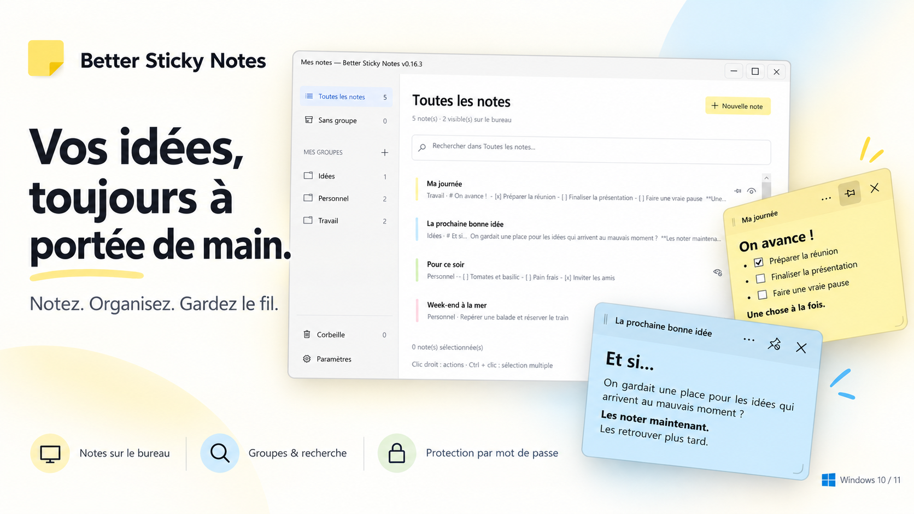

# Better Sticky Notes



Des post-it pour Windows 10/11 : notes colorées, Markdown, groupes et sauvegarde automatique. Sans compte ni synchronisation réseau.

## Télécharger et démarrer

**[Télécharger la dernière version pour Windows x64](https://github.com/morganbksys-pixel/better-sticky-notes/releases/latest)**

Extraire entièrement le ZIP, puis lancer `BetterStickyNotes.exe`. Aucun installateur ni installation de .NET nécessaire.

L’application s’ouvre sur **Mes notes**, pour créer, rechercher et organiser vos notes. Double-cliquer sur une ligne affiche le post-it correspondant. Les post-it restent masqués au démarrage jusqu’à leur ouverture.

## L’essentiel

- **Post-it personnalisables** : couleur, déplacement, redimensionnement, repli sur le titre et punaise pour rester au premier plan. La punaise est en contour quand la note est libre et pleine quand elle est épinglée.
- **Markdown** : titres, gras, italique, listes, cases à cocher interactives, liens et code. Double-cliquer sur le contenu pour le modifier.
- **Organisation** : groupes colorés, recherche dans les titres et contenus, sélection multiple et actions par clic droit. Les notes sont triées de la plus récente à la plus ancienne selon leur dernière modification (titre, contenu, case à cocher ou ajout/suppression de capture), ou leur date de création si elles n’ont pas encore été modifiées. Créer ou modifier une note la fait remonter en haut de la liste. Les actions d’affichage, de déplacement, d’épinglage et de verrouillage ne changent pas cet ordre. Les anciennes notes sans date restent après les notes datées et conservent leur ordre enregistré jusqu’à leur prochaine modification.
- **Captures d’écran** : joindre l’écran du post-it à une note, consulter les images avec zoom ou les retrouver dans la galerie **Captures**. La petite poignée centrale du bas déplie ou replie les vignettes ; la molette et les flèches permettent de les parcourir sans barre de défilement visible.
- **Protection par mot de passe** : chiffrer le titre et le contenu des notes confidentielles.
- **Corbeille** : restaurer les notes supprimées ou les effacer définitivement après confirmation. La purge automatique est facultative et désactivée par défaut.

Le repli, la recherche dans un post-it et la galerie de captures sont disponibles à partir de la version **0.21.4**.

Dans la galerie, les boutons **Notes actives / Corbeille** permettent de choisir les captures affichées. Un clic sélectionne, un double-clic ou **Entrée** ouvre l’image. **Ctrl+clic** et **Maj+clic** sélectionnent plusieurs captures ; les **flèches** déplacent la sélection. **Ctrl+A** sélectionne tout, **Échap** désélectionne, **Ctrl+C** copie l’image (ou les fichiers si plusieurs), **Ctrl+S** enregistre et **Suppr** retire les captures après confirmation. L’export multiple choisit un dossier sans écraser ses fichiers. Les captures de la corbeille restent consultables et exportables. Dans la visionneuse, **Ctrl+molette** zoome et **← / →** parcourt les captures en boucle.

Le bouton **œil barré** masque un post-it sans supprimer sa note. Dans Mes notes, un **œil ouvert** indique une note visible et un **œil barré** une note masquée ; l’infobulle précise l’action au clic. Les menus des notes et des groupes utilisent les mêmes icônes. Pour retrouver **Mes notes**, relancer l’application ou double-cliquer sur son icône jaune dans la zone de notification. Le clic droit sur cette icône permet aussi de créer une note ou de quitter.

Dans **Mes notes → Paramètres**, l’option **Démarrer avec Windows** lance l’application en arrière-plan, sans ouvrir de fenêtre. Elle est désactivée par défaut.

### Raccourcis utiles

| Raccourci | Action |
| --- | --- |
| `Ctrl+N` | Créer une note |
| `F2` | Renommer la note ou le groupe ciblé |
| `Ctrl+Entrée` | Basculer entre édition et aperçu |
| `Ctrl+F` | Rechercher dans le post-it |
| `Ctrl+Maj+M` | Replier ou déplier le post-it |
| `Ctrl+Maj+S` | Capturer l’écran du post-it |
| `Ctrl+A` / `Suppr` | Sélectionner toutes les notes / les mettre à la corbeille, lorsque la liste a le focus |

## Importer depuis Sticky Notes

Dans **Mes notes → Paramètres → Importer depuis Sticky Notes…**, suivre les étapes puis sélectionner les notes à récupérer. Fermer Sticky Notes / OneNote avant l’import.

L’import accepte les bases locales Sticky Notes (`plum.sqlite`) et les post-it de la nouvelle expérience OneNote (`notes.sdk_*.db`). Le texte, les listes et les couleurs sont récupérés ; les images, les fichiers `.snt`, les blocs-notes `.one` et les notes uniquement dans le cloud ne sont pas pris en charge.

La source reste intacte. Un nouvel import ignore les notes déjà importées : il ne synchronise pas leurs modifications.

## Données et confidentialité

Les données restent dans `%LocalAppData%\BetterStickyNotes`, accessible depuis **Paramètres → Ouvrir le dossier des données**. L’enregistrement est automatique, avec une copie de secours `.bak`.

Pour sauvegarder ou transférer vos notes, **quitter l’application puis copier le dossier entier**, y compris le sous-dossier `captures`. Sur le poste de destination, quitter également l’application avant de remplacer les données. Éviter de rouvrir ces données avec une ancienne version.

- Le menu **⋯ → Protéger par mot de passe…** utilise un mot de passe commun aux notes protégées. **Un mot de passe oublié ne peut pas être récupéré.**
- Les notes protégées se reverrouillent lorsqu’elles sont masquées, à la fermeture de leur fenêtre et au verrouillage de Windows. Verrouillées, elles restent anonymes et sont exclues des recherches non vides.
- Dans Mes notes, un seul cadenas remplace l’œil pour les notes protégées : fermé si la note est verrouillée, ouvert si elle est déverrouillée.
- Le titre et le contenu protégés sont chiffrés avec AES-256-GCM. Les métadonnées, dont les noms de groupes, restent lisibles. Les anciennes copies externes peuvent encore contenir du texte en clair.
- Les captures ne sont pas chiffrées : elles sont indisponibles dans les notes protégées et doivent être retirées avant de protéger une note.

## Développement

Prérequis : Windows et SDK .NET 10. Application en C# / WPF.

```powershell
dotnet build BetterStickyNotes.csproj
dotnet run --project BetterStickyNotes.csproj
dotnet run --project tests/SmokeTests.csproj
./publish.ps1
```

Quitter l’application avant de tester une autre compilation. La suite complète peut afficher des fenêtres de test ; l’option `--quiet-ui` lance les vérifications sans affichage.

Le workflow GitHub Actions [Tests .NET](.github/workflows/dotnet.yml) s’exécute à chaque push et pull request, et peut être lancé manuellement depuis l’onglet **Actions**. Il installe le SDK .NET 10 et le dictionnaire français sur un runner Windows, compile en Release, puis lance les vérifications `--quiet-ui` et la suite complète avec `dotnet run` (le projet utilise un exécutable de tests STA, pas `dotnet test`). Les interactions réelles avec la barre des tâches, la zone de notification, le verrouillage de session et les écrans restent à vérifier manuellement.

La publication produit l’exécutable et le ZIP autonome dans `dist/BetterStickyNotes-<version>/` et `dist/`, et conserve les trois dernières versions.

Pour les détails sur le stockage, le chiffrement, les tests et la publication, consulter la [documentation technique](docs/TECHNIQUE.md).
